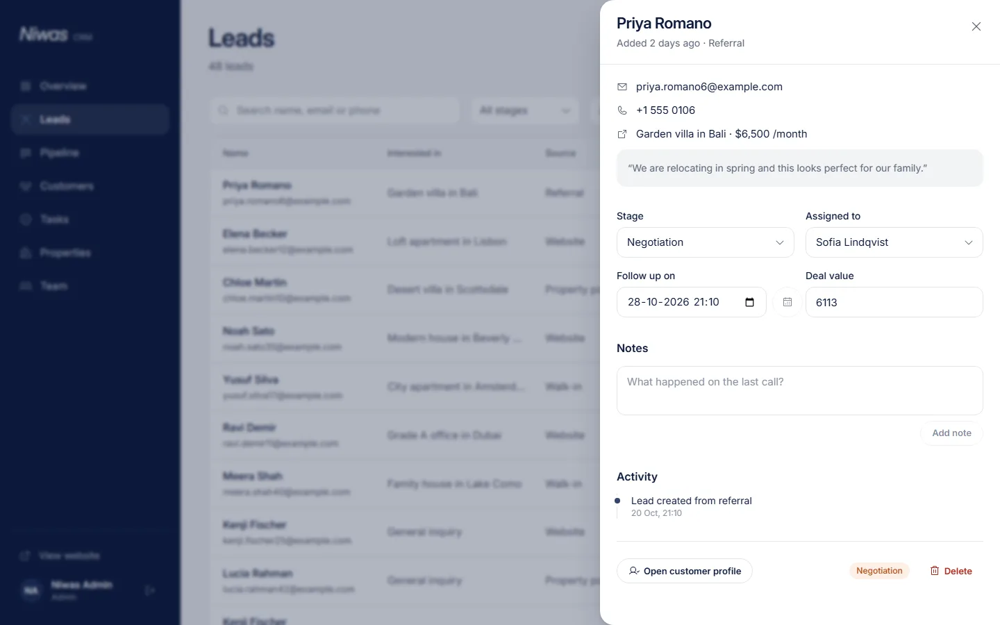

# Niwas: Real Estate Website & CRM

A real estate website where buyers and renters browse and inquire about properties, connected to a CRM where agents and admins manage listings, leads, customers and the sales pipeline.

Built with **React, Node.js/Express and MongoDB** for the Anuverse Technologies full-stack assignment.

| | |
|---|---|
| **Live website** | _add after deploy_ |
| **API** | _add after deploy_ |
| **Demo logins** | see [Demo accounts](#demo-accounts) |


---

## Features

### Website
- **Home page** built from the provided design: hero with location search, partner strip, story, popular and featured carousels, live trust numbers, testimonial, call to action.
- **Property search** with filters for location, buy or rent, residential or commercial, type, price range and bedrooms. Filters live in the URL, so results are shareable and the back button works. Includes sorting, pagination, and a bottom-sheet filter panel on mobile.
- **Property pages** with photo gallery and full-screen lightbox (keyboard and swipe), key facts, amenities, agent card, similar homes and an **inquiry form** that becomes a CRM lead.
- **Accounts** (email and password): save homes with the heart button, and see the status of your inquiries under "My inquiries".
- **Responsive** from 360 px phones to wide desktops, with no horizontal scroll at any width (checked at 360, 390, 768, 1024 and 1440 px).

### CRM (`/dashboard`, agents and admins)
- **Overview**: KPIs (available properties, new leads with change vs the previous 30 days, active clients, sales this month), 12-month sales chart, pipeline and lead-source charts, lead follow-ups due today or overdue, recent leads.
- **Leads**: searchable, filterable table (stage, source, follow-up, agent). A detail drawer covers contact info, stage, assignment, follow-up date, deal value, notes, an activity log, and conversion to a customer.
- **Pipeline**: drag-and-drop Kanban (New → Contacted → Qualified → Site visit → Negotiation → Won/Lost) with optimistic updates. Winning a deal asks for the final value, creates or updates the customer and marks the property sold or rented. Losing asks for a reason.
- **Customers**: profiles with requirements (budget, cities, types, bedrooms), an interaction timeline (calls, emails, meetings, visits, notes), deals, linked leads and **matching properties**.
- **Properties**: add, edit and delete listings, with **photo upload to Cloudinary** (drag and drop, reorder, choose cover), draft/available/under offer/sold/rented status, and a featured flag.
- **Team** (admin only): promote buyers to agents, change roles, deactivate accounts, see each agent's open leads, deals and revenue.

### Roles

| | Visitor | Buyer | Agent | Admin |
|---|:-:|:-:|:-:|:-:|
| Browse, search, send inquiries | ✅ | ✅ | ✅ | ✅ |
| Save homes, see own inquiries | | ✅ | ✅ | ✅ |
| CRM: leads, customers | | | **own only** | all |
| Add and edit listings | | | **own only** | all |
| Reassign leads, delete records, manage team | | | | ✅ |

Agents only ever see records assigned to them. The API enforces this on every request; hiding things in the UI is a convenience, not the protection.

---

## Tech stack

| Layer | Choice |
|---|---|
| Frontend | React 19, Vite, Tailwind CSS v4, Motion (Framer Motion), React Router, TanStack Query, React Hook Form + Zod, Recharts, dnd-kit |
| Backend | Node.js 22, Express 5, Mongoose, Zod, Helmet, express-rate-limit |
| Database | MongoDB Atlas |
| Auth | Own email/password auth (bcrypt + JWT) with role-based access control |
| Images | Cloudinary (signed direct uploads), Unsplash for seed photos |
| Tests | Vitest + Supertest + mongodb-memory-server (46 API tests) |
| Hosting | Vercel (frontend and API as two projects) |

Architecture, data flow and the reasoning behind each decision: **[docs/ARCHITECTURE.md](docs/ARCHITECTURE.md)**.

---

## Run it locally

Requirements: **Node.js 20+** and npm.

### Option A: zero setup (about 2 minutes)

No database or accounts needed. The API runs on an in-memory MongoDB seeded with demo data, including staff accounts you can sign in with.

```bash
# terminal 1: API on http://localhost:5000
cd backend
npm install
npm run dev:memory

# terminal 2: website on http://localhost:5173
cd frontend
npm install
npm run dev
```

Open http://localhost:5173/sign-in, sign in as `admin@niwas.app` with password `niwas-demo-2026`, and go to **/dashboard**. The agents in [Demo accounts](#demo-accounts) use the same password. Data resets when the API stops.

### Option B: real setup (Atlas + Cloudinary)

1. **MongoDB Atlas**: create a free cluster and a database user. Under *Network access*, allow `0.0.0.0/0` (Vercel has no fixed IPs). Copy the connection string.
2. **Cloudinary** (optional; without it, photos can be added by link): copy the cloud name, API key and API secret.
3. Configure and run:

```bash
cd backend
cp .env.example .env          # fill in MONGODB_URI, JWT_SECRET, ADMIN_EMAILS, CLOUDINARY_*
npm install
npm run seed                  # demo listings, leads and customers
npm run dev

cd ../frontend
cp .env.example .env.local    # nothing to fill in for local dev
npm install
npm run dev
```

4. Create an account at `/sign-up` with an email listed in `ADMIN_EMAILS` and you become an admin. Everyone else signs up as a normal user; promote accounts from **Dashboard → Team**.

### Environment variables

**backend/.env**

| Variable | Required | Purpose |
|---|---|---|
| `MONGODB_URI` | yes | Atlas connection string |
| `CLIENT_URL` | yes | Frontend origin(s) allowed by CORS, comma separated |
| `JWT_SECRET` | in production | Signs session tokens (32+ random characters). A dev-only key is used locally if unset |
| `JWT_EXPIRES_IN` | no | Session length, default `7d` |
| `ADMIN_EMAILS` | yes | Emails that become admin when they register |
| `SEED_PASSWORD` | no | Password for the demo staff accounts, default `niwas-demo-2026` |
| `DNS_SERVERS` | no | DNS resolvers for the Atlas SRV lookup, if it fails with `querySrv ECONNREFUSED` |
| `CLOUDINARY_CLOUD_NAME`, `CLOUDINARY_API_KEY`, `CLOUDINARY_API_SECRET` | no | Photo uploads |

**frontend/.env.local**

| Variable | Required | Purpose |
|---|---|---|
| `VITE_API_URL` | in production | Deployed API origin, for example `https://niwas-api.vercel.app` (in dev, `/api` is proxied) |

### Scripts

| Where | Command | What it does |
|---|---|---|
| backend | `npm run dev` | API with auto-reload (needs `.env`) |
| backend | `npm run dev:memory` | API on an in-memory, pre-seeded database |
| backend | `npm run seed` | Reset the database to the demo data |
| backend | `npm test` | Run the 46 API tests |
| frontend | `npm run dev` / `npm run build` | Dev server / production build |

---

## Demo accounts

`npm run seed` creates these staff accounts with the password `niwas-demo-2026` (or `SEED_PASSWORD`). An account that already exists keeps its own password.

| Role | Email |
|---|---|
| Admin | `admin@niwas.app` (or the first email in `ADMIN_EMAILS`) |
| Agent | `aarav@niwas.app` (Aarav Mehta) |
| Agent | `sofia@niwas.app` (Sofia Lindqvist) |
| Agent | `daniel@niwas.app` (Daniel Okafor, commercial) |

---

## Deploy to Vercel

Create **two Vercel projects** from this repository:

| Project | Root directory | Environment variables |
|---|---|---|
| API | `backend` | everything from `backend/.env`, with `NODE_ENV=production` and `CLIENT_URL=https://<your-frontend>.vercel.app` |
| Website | `frontend` | `VITE_API_URL=https://<your-api>.vercel.app` |

- `backend/vercel.json` routes every request to `api/index.js`, which exports the Express app as a serverless function.
- `frontend/vercel.json` rewrites all paths to `index.html` so deep links work.
- Set a strong `JWT_SECRET` on the API project; it refuses to start in production without one.
- Run `npm run seed` once against the Atlas database from your machine.

---

## Project structure

```
backend/
  api/index.js            Vercel entry (exports the Express app)
  src/app.js              middleware chain and routes
  src/auth/               token signing and password hashing
  src/middleware/         auth + roles, validation, sanitising, errors
  src/models/             User, Property, Lead, Customer
  src/modules/<feature>/  routes, controllers, schemas, services per feature
  src/scripts/            seed and dev:memory
  tests/                  API tests (in-memory MongoDB)
frontend/
  src/auth/               AuthContext: session token, current user and role
  src/components/ui/      design-system primitives
  src/components/site/    website components
  src/components/crm/     CRM components
  src/pages/site/         public pages
  src/pages/crm/          dashboard pages (lazy-loaded)
  src/hooks/              TanStack Query hooks per resource
  src/lib/                api client, formatting, motion tokens, uploads
docs/
  PRD.md                  requirements
  DESIGN.md               design system and motion rules
  ARCHITECTURE.md         architecture and key decisions
  screenshots/
```

## Screenshots

| | |
|---|---|
|  |  |
|  |  |
|  |  |
