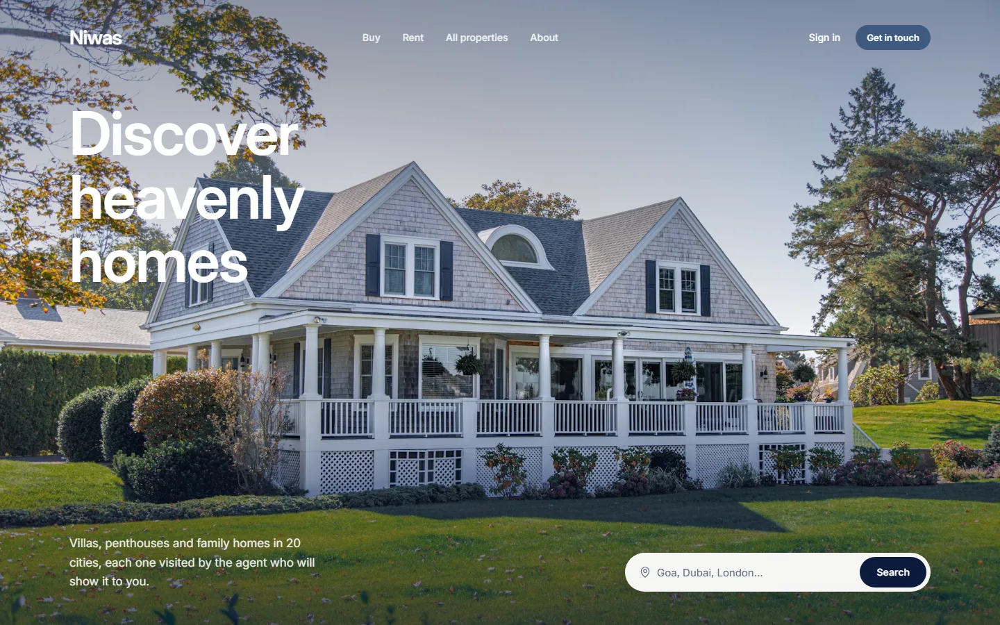
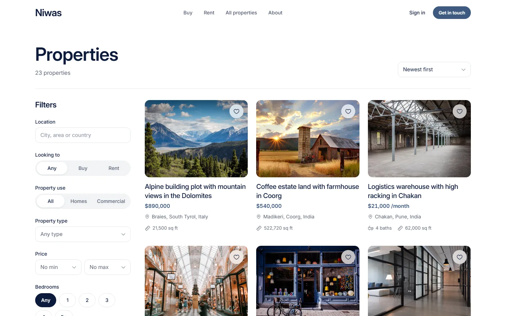
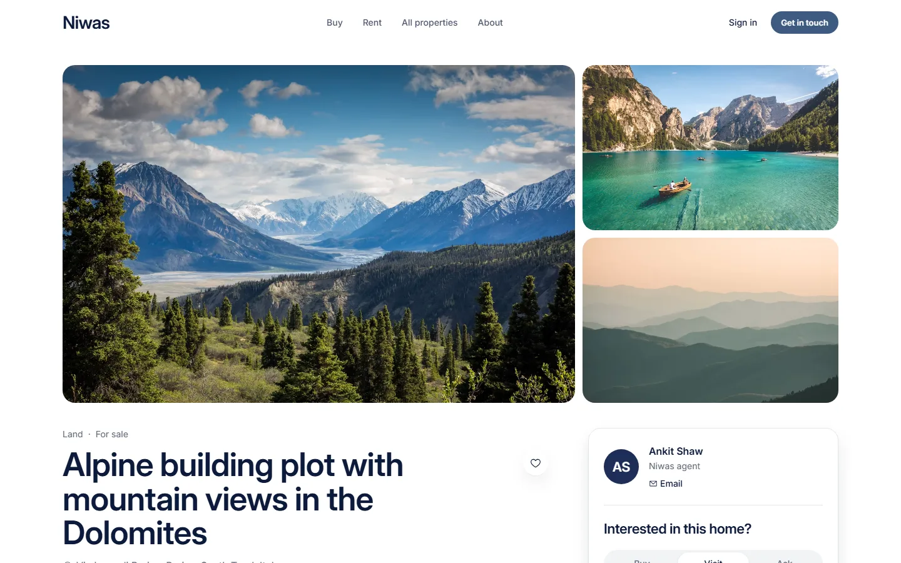
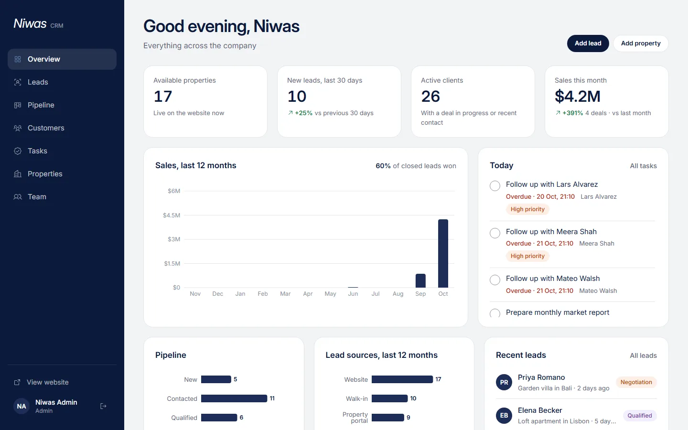
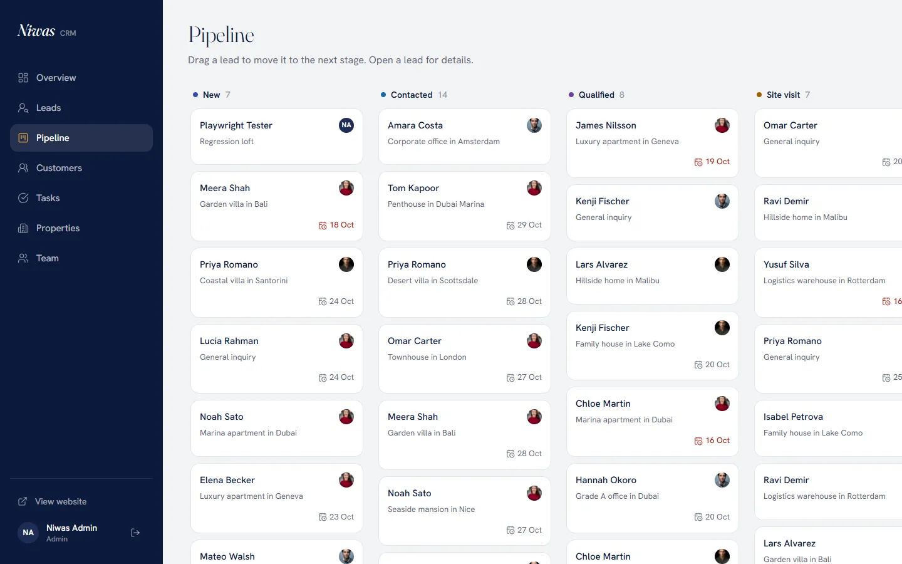
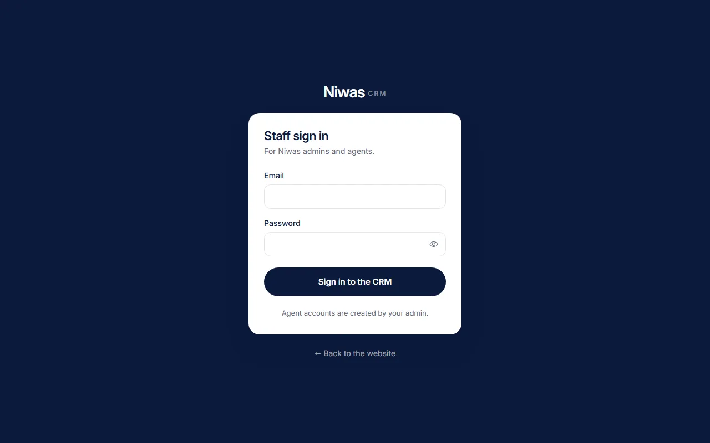
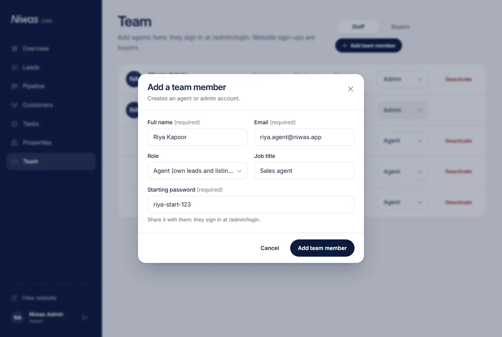
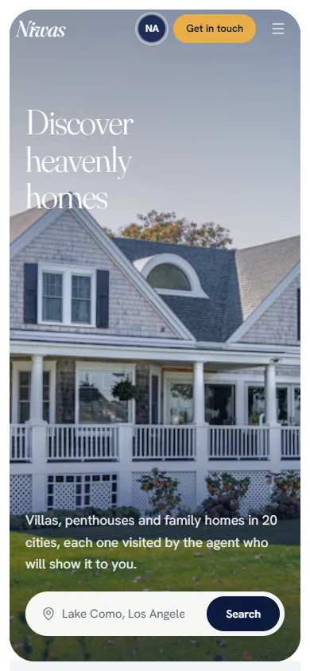
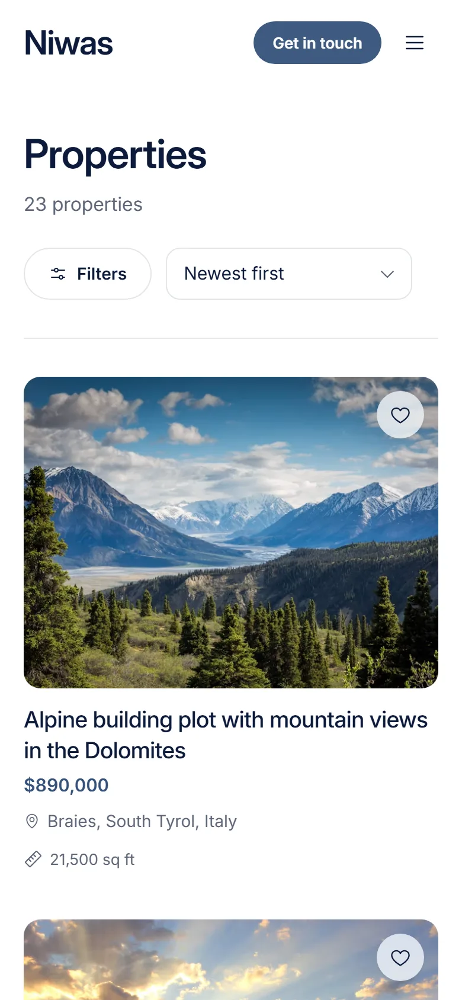
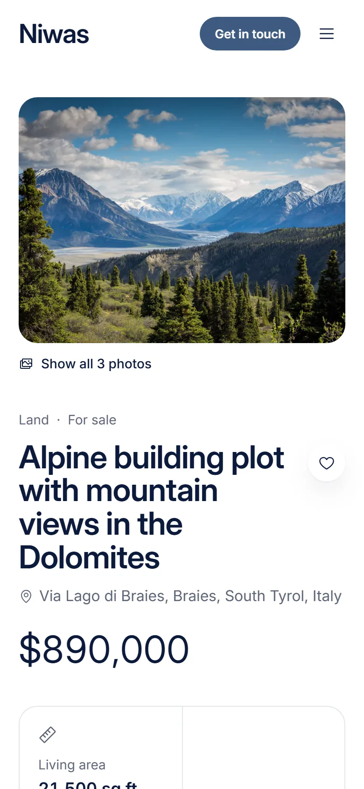

# Niwas: Real Estate Website & CRM

A real estate website where buyers and renters browse and inquire about residential and commercial properties, connected to a CRM where agents and administrators manage properties, leads, customers, the sales pipeline and follow-up tasks.

Built with **React, Node.js/Express and MongoDB** for the Anuverse Technologies full-stack assignment.

| | |
|---|---|
| **Live website** | https://assignment-real-estate-alpha.vercel.app |
| **REST API** | https://assignment-real-estate-backend.vercel.app (health check: [/api/health](https://assignment-real-estate-backend.vercel.app/api/health)) |
| **Source code** | https://github.com/AnkitShaw-100/Assignment-Real-Estate |
| **CRM (staff)** | https://assignment-real-estate-alpha.vercel.app/admin/login (demo logins are shared in the submission email) |
| **Website accounts** | Anyone can sign up at [/sign-up](https://assignment-real-estate-alpha.vercel.app/sign-up) to save homes and track inquiries |



---

## Contents

1. [Assignment requirements and where they are met](#assignment-requirements-and-where-they-are-met)
2. [Features](#features)
3. [Roles and access](#roles-and-access)
4. [Using the CRM](#using-the-crm)
5. [Tech stack](#tech-stack)
6. [Architecture](#architecture)
7. [Key technical decisions](#key-technical-decisions)
8. [Security](#security)
9. [REST API](#rest-api)
10. [Run it locally](#run-it-locally)
11. [Deployment](#deployment)
12. [Project structure](#project-structure)
13. [Known limitations](#known-limitations)
14. [Screenshots](#screenshots)

---

## Assignment requirements and where they are met

### 1. Real estate website

| Requirement | Implementation |
|---|---|
| Residential and commercial listings | `/properties` lists both, with a Homes / Commercial switch. Types: villa, house, apartment, penthouse, office, shop, warehouse, land. |
| Search with filters for location, price, type and bedrooms | Location search with city suggestions, buy / rent, residential / commercial, property type, min and max price, bedrooms, sorting and pagination. Filters live in the URL, so a filtered search can be shared and the back button works. |
| Property pages with images, description, amenities, pricing and contact form | `/properties/:slug`: photo gallery with full-screen lightbox, key facts, amenities, price (sale or monthly rent), listing agent and similar homes. |
| Inquiry forms for buyers and renters | Inquiry form on every property page (Buy / Rent / Visit / Ask) and on `/contact`. Each inquiry becomes a lead in the CRM, assigned to an agent automatically. |
| Responsive design | Built mobile-first. Checked at 360, 390, 768, 1024 and 1440 px with no horizontal scroll. Filters become a bottom sheet on phones. |

### 2. CRM dashboard (`/admin`)

| Requirement | Implementation |
|---|---|
| Total properties, new leads, active clients and sales performance | **Overview**: KPI cards (available properties, new leads in the last 30 days with change vs the previous 30, active clients, sales this month), a 12-month sales chart, pipeline and lead-source charts, today's tasks and recent leads. |
| Lead management: status, contact details, source, follow-up dates | **Leads**: searchable table with filters for stage, source, follow-up (overdue / today / upcoming) and agent. The lead drawer has contact details, stage, assignment, follow-up date, deal value, notes and a full activity log. |
| Customer management: profiles, requirements, interaction history | **Customers**: profiles with requirements (budget, cities, property types, bedrooms), an interaction timeline (calls, emails, meetings, site visits, notes), deals, linked leads and **matching properties** based on their requirements. |
| Sales pipeline from inquiry to conversion | **Pipeline**: drag-and-drop board (New → Contacted → Qualified → Site visit → Negotiation → Won / Lost). Marking a lead Won records the deal value, creates or updates the customer and marks the property sold or rented. Lost asks for a reason. |
| Task and follow-up management for agents | **Tasks**: overdue / today / upcoming / completed views, quick add, one-click completion. Setting a follow-up date on a lead creates the follow-up task automatically and keeps it in sync. |
| Add, edit, update and remove listings | **Properties**: add and edit in a modal form with photo upload (drag and drop, reorder, choose cover), status (draft / available / under offer / sold / rented) and a featured flag. Delete with confirmation. |

### 3. Technical requirements

| Requirement | Implementation |
|---|---|
| React.js frontend | React 19 + Vite |
| Node.js and Express.js backend | Node.js 22, Express 5 |
| MongoDB | MongoDB Atlas with Mongoose |
| RESTful APIs for properties, leads, customers and users | See [REST API](#rest-api). Also tasks, dashboard stats, auth and uploads. |
| Authentication and role-based access for admins and agents | Own email/password auth (bcrypt + JWT). Roles `buyer`, `agent` and `admin` are enforced by the API on every request. See [Roles and access](#roles-and-access). |
| Form validation, error handling, security measures | Zod schemas on both client and server, one consistent error format, field-level error messages. See [Security](#security). |

---

## Features

### Website
- **Home page** following the provided design: full-width hero with location search, partner agencies, company story, popular and featured listings, live trust numbers, client reviews and a call to action.
- **Property search and detail pages** as described above.
- **Accounts**: sign up and sign in with email and password. Signed-in users can save homes (heart button) and follow the status of their inquiries under "My inquiries".
- **Polish**: skeleton loading for pages and images, styled dropdowns and city suggestions with keyboard support, colour-coded notifications, and reduced motion when the OS asks for it.

### CRM
- **Overview, Leads, Pipeline, Customers, Tasks and Properties** as described in the requirements table.
- **Team** (admin only): add agents (or more admins) with a starting password, change roles, deactivate accounts, and see each agent's open leads, deals won and revenue.
- **Row-level scoping**: agents see only their own leads, customers, tasks and listings; admins see everything.

---

## Roles and access

| | Visitor | Buyer (normal user) | Agent | Admin |
|---|:-:|:-:|:-:|:-:|
| Browse, search, send inquiries | ✅ | ✅ | ✅ | ✅ |
| Save homes, see own inquiries | | ✅ | ✅ | ✅ |
| CRM: leads, customers, pipeline, tasks | | | own records | all records |
| Add and edit listings | | | own listings | all listings |
| Reassign leads, delete records, manage team and roles | | | | ✅ |

- **Two entrances.** Visitors use `/sign-up` and `/sign-in`, and every public sign-up is a **buyer**. Staff use **`/admin/login`**, which has no sign-up and refuses accounts without CRM access (checked by the API, not just the page).
- **The admin** is defined by `ADMIN_EMAIL` and `ADMIN_PASSWORD` in the server settings. Signing in with them creates the account on first use; the email can't be claimed through public sign-up.
- **Agents** are added by the admin under **Team → Add team member**, with a starting password they sign in with at `/admin/login`.
- The role is read from the database on every request, so a role change or deactivation takes effect immediately.
- Hiding CRM pages in the UI is only a convenience. The API is the real gate.

---

## Using the CRM

**Signing in as the admin**
1. Open **`/admin/login`**. Signed-out visits to any `/admin/...` page land here too, and old `/dashboard` links redirect to `/admin`.
2. Sign in with the `ADMIN_EMAIL` and `ADMIN_PASSWORD` set in the API's environment. The admin account is created on the first sign-in.

**Adding an agent**
1. Go to **Team → Add team member** (admins only).
2. Enter name, email, role (**Agent** or **Admin**), an optional job title and a **starting password** (8+ characters).
3. Share the email, the password and the `/admin/login` link with them.

**How an agent signs in**
- At the same **`/admin/login`** page, with the email and starting password the admin gave them.
- Agents see Overview, Leads, Pipeline, Customers, Tasks and Properties, limited to their own records. They don't see Team.
- A normal website account that tries `/admin/login` is refused with "This account doesn't have CRM access".

**Managing the team**
- Change someone's role, or click **Deactivate** to remove access. Both take effect on their next request.
- Website sign-ups appear under **Team → Buyers**.

---

## Tech stack

| Layer | Choice |
|---|---|
| Frontend | React 19, Vite, Tailwind CSS v4, React Router, TanStack Query, React Hook Form + Zod, Motion, Recharts, dnd-kit, react-icons, Sonner |
| Backend | Node.js 22, Express 5, Mongoose, Zod, bcryptjs, jsonwebtoken, Helmet, express-rate-limit |
| Database | MongoDB Atlas |
| Images | Cloudinary (signed direct uploads) and Unsplash for demo photos |
| Testing | Vitest + Supertest + mongodb-memory-server (54 API tests) |
| Hosting | Vercel (website and API deployed as two projects) |

---

## Architecture

```
 Browser (React SPA)
 ├─ Website   /, /properties, /properties/:slug, /contact, /sign-in …
 └─ CRM       /admin/*  (staff sign-in at /admin/login, lazy-loaded, role-gated)
        │  REST/JSON over HTTPS, "Authorization: Bearer <JWT>"
        ▼
 Express API (Vercel serverless function)
   helmet → CORS allowlist → JSON body limit → NoSQL-injection sanitiser
   → rate limit → DB connection (cached) → attachUser (verify JWT, load role)
   → route guard (auth / staff / admin) → Zod validation → controller / service
   → central error handler
        │                                   ▲
        ▼                                   │ signed upload
 MongoDB Atlas (Mongoose)            Cloudinary (images)
 User · Property · Lead · Customer · Task
```

- **Frontend**: the website and the CRM share one React app and one design system. CRM pages are code-split, so website visitors never download dashboard code. Server data goes through TanStack Query hooks (`hooks/usePublic.js`, `hooks/useCrm.js`). Filters, the open lead and open modals live in the URL.
- **Backend**: organised by feature (`src/modules/<feature>/`: routes, controllers, schemas, services). Business rules such as stage changes, deal creation and follow-up task sync live in services, not in route handlers.
- **Data model**: a Lead links a Property, an assigned agent (User) and, once converted, a Customer. A Customer holds requirements, an interaction timeline and deals. Tasks belong to an agent and can link a lead or customer.

The full write-up, with the request lifecycle, data model and business flows, is in **[docs/ARCHITECTURE.md](docs/ARCHITECTURE.md)**.

---

## Key technical decisions

| Decision | Why | Trade-off |
|---|---|---|
| Own email/password auth with JWT, roles read from the DB per request | No third-party dependency; role changes and deactivation apply instantly; the whole flow is covered by tests | Password reset and email verification are not built yet |
| Admin defined in server settings (`ADMIN_EMAIL` / `ADMIN_PASSWORD`); agents created by the admin | Nobody can make themselves staff: public sign-up is always a buyer, the CRM sign-in refuses non-staff, and there is no secret URL to leak | One admin comes from the settings; more admins are added from Team |
| Bearer token instead of cookies | The website and the API are separate Vercel deployments on different domains, where browsers often block cross-site cookies | The token lives in `localStorage`, so XSS protection matters (React escaping, Helmet headers) |
| Out-of-scope records return **404, not 403** | An agent can't discover that another agent's lead exists by probing IDs | Slightly less explicit when debugging |
| Signed direct uploads to Cloudinary | Files go straight from the browser to Cloudinary, avoiding Vercel's 4.5 MB request limit, and the secret never leaves the server | Two round trips per upload |
| Zod on client and server | The same rules everywhere; the server strips unknown fields, which blocks mass assignment (for example sending `role: "admin"`) | Schemas are duplicated, to keep the two apps independently deployable |
| Express as a serverless function with a cached DB connection | One hosting platform and free tier for both apps | Cold start on the first request after idle |
| Follow-up tasks generated from a lead's follow-up date | Agents set the date once and the task list stays correct when it changes or the lead closes | Task logic is coupled to the lead service |

---

## Security

- **Passwords** hashed with bcrypt (cost 12) and never returned by the API.
- **JWT** signed with HS256, with issuer and expiry checks. `JWT_SECRET` is required in production.
- **Role-based access** enforced server-side on every route, plus row-level scoping for agents.
- **Validation**: every body, query and URL parameter is parsed by a Zod schema, and unknown fields are dropped.
- **NoSQL injection**: keys starting with `$` or containing `.` are stripped from all input.
- **Rate limiting**: 300 requests / 15 min per IP on the API, 20 / 15 min on sign-in and sign-up, 5 / 10 min on the public inquiry form (which also has a honeypot field).
- **Sign-in** returns the same message for an unknown email and a wrong password, with equal timing.
- **Staff access**: the admin password is compared in constant time and lives only in the server settings; the admin email can't be registered publicly; the CRM sign-in (`staff: true`) refuses accounts without CRM access.
- **Helmet** security headers, a **CORS allowlist** (`CLIENT_URL`) and a 1 MB JSON body limit.
- **Errors** use one shape, `{ error: { message, details? } }`. Unexpected errors return a generic 500 without internal details.

---

## REST API

All routes are under `/api`. Responses are JSON: `{ data }` on success, `{ error: { message, details? } }` on failure.

| Resource | Endpoints | Access |
|---|---|---|
| Auth | `POST /auth/register` (always a buyer), `POST /auth/login` (send `"staff": true` from the CRM sign-in to refuse non-staff) | public |
| Properties | `GET /properties`, `GET /properties/cities`, `GET /properties/:slug`, `GET /properties/:slug/similar` | public |
| | `GET /properties/id/:id`, `POST /properties`, `PATCH /properties/:id`, `DELETE /properties/:id` | agent (own) / admin |
| Leads | `POST /leads/inquiry` | public, rate-limited |
| | `GET /leads/mine` | signed in |
| | `GET /leads`, `POST /leads`, `GET /leads/:id`, `PATCH /leads/:id`, `PATCH /leads/:id/stage`, `POST /leads/:id/convert` | agent (own) / admin |
| | `DELETE /leads/:id` | admin |
| Customers | `GET /customers`, `POST /customers`, `GET /customers/:id`, `PATCH /customers/:id`, `GET /customers/:id/matches` | agent (own) / admin |
| | `DELETE /customers/:id` | admin |
| Tasks | `GET /tasks`, `POST /tasks`, `PATCH /tasks/:id`, `DELETE /tasks/:id` | agent (own) / admin |
| Users | `GET /users/me`, `PATCH /users/me`, `GET /users/me/saved`, `POST/DELETE /users/me/saved/:propertyId` | signed in |
| | `GET /users/agents` | agent / admin |
| | `GET /users`, `POST /users` (add team member), `PATCH /users/:id/role`, `PATCH /users/:id/active` | admin |
| Dashboard | `GET /dashboard/overview` | agent (own) / admin |
| Stats | `GET /stats/public` | public |
| Uploads | `POST /uploads/signature` | agent / admin |

---

## Run it locally

Requirements: **Node.js 22** and npm.

### Option A: no setup (about 2 minutes)

No database or accounts needed. The API runs on an in-memory MongoDB filled with demo data, including staff accounts.

```bash
# terminal 1: API on http://localhost:5000
cd backend
npm install
npm run dev:memory

# terminal 2: website on http://localhost:5173
cd frontend
npm install
npm run dev
```

The API prints the demo logins when it starts: `admin@niwas.app` plus agents `aarav@niwas.app`, `sofia@niwas.app` and `daniel@niwas.app`, all with a random password generated for that run (set `SEED_PASSWORD` to choose your own). Sign in at http://localhost:5173/admin/login. Data resets when the API stops.

### Option B: with MongoDB Atlas

1. **MongoDB Atlas**: create a free cluster and a database user. Under *Network access*, allow `0.0.0.0/0` (Vercel has no fixed IPs). Copy the connection string.
2. **Cloudinary** (optional): copy the cloud name, API key and API secret. Without them, photos can be added by URL.
3. Configure and run:

```bash
cd backend
cp .env.example .env      # fill in MONGODB_URI, JWT_SECRET, ADMIN_EMAIL, ADMIN_PASSWORD (and CLOUDINARY_* if used)
npm install
npm run seed              # optional: demo listings, leads, customers and tasks (replaces existing data)
npm run dev

cd ../frontend
cp .env.example .env.local
npm install
npm run dev
```

4. Sign in at `/admin/login` with your `ADMIN_EMAIL` and `ADMIN_PASSWORD`, then add agents under **Team**.

### Environment variables

**backend/.env**

| Variable | Required | Purpose |
|---|---|---|
| `MONGODB_URI` | yes | Atlas connection string |
| `CLIENT_URL` | yes | Allowed frontend origin(s) for CORS, comma separated |
| `JWT_SECRET` | in production | Signs session tokens (32+ random characters) |
| `JWT_EXPIRES_IN` | no | Session length, default `7d` |
| `ADMIN_EMAIL`, `ADMIN_PASSWORD` | yes | The admin account for the CRM (`/admin/login`). Keep the password only in your server settings |
| `SEED_PASSWORD` | no | Password for demo staff accounts created by `npm run seed` (random and printed if unset) |
| `DNS_SERVERS` | no | DNS resolvers for the Atlas lookup, if startup fails with `querySrv ECONNREFUSED` |
| `CLOUDINARY_CLOUD_NAME`, `CLOUDINARY_API_KEY`, `CLOUDINARY_API_SECRET` | no | Photo uploads |

**frontend/.env.local**

| Variable | Required | Purpose |
|---|---|---|
| `VITE_API_URL` | in production | Deployed API origin. Leave empty locally, where `/api` is proxied to `localhost:5000` |

### Scripts

| Where | Command | What it does |
|---|---|---|
| backend | `npm run dev` | API with auto-reload |
| backend | `npm run dev:memory` | API on an in-memory, pre-filled database |
| backend | `npm run seed` | Reset the database to the demo data |
| backend | `npm test` | Run the 54 API tests |
| frontend | `npm run dev` | Development server |
| frontend | `npm run build` | Production build |

### Tests

`npm test` in `backend/` runs 54 API tests against an in-memory MongoDB. They cover auth (registration, admin and staff-only sign-in, adding team members, forged and expired tokens, deactivated accounts), role and row-level access, validation and injection handling, the inquiry → lead → pipeline → customer flow, deals and property status, tasks and follow-ups, and customer matching.

---

## Deployment

Two Vercel projects from this repository:

| Project | Root directory | Environment variables |
|---|---|---|
| API | `backend` | everything from `backend/.env` (including `ADMIN_EMAIL` and `ADMIN_PASSWORD`), plus `NODE_ENV=production` and `CLIENT_URL=https://assignment-real-estate-alpha.vercel.app` |
| Website | `frontend` | `VITE_API_URL=https://assignment-real-estate-backend.vercel.app` |

- `backend/vercel.json` sets `framework: null` (plain serverless function) and rewrites every path to `api/index.js`, which re-exports the app from `src/server.js`. On Vercel that file doesn't listen or connect at startup; each request connects lazily (cached per instance).
- `frontend/vercel.json` rewrites all paths to `index.html`, so deep links work.
- The website calls the API directly at `VITE_API_URL`; the API allows it through its CORS allowlist (`CLIENT_URL`).
- The API refuses to start in production without `JWT_SECRET`.
- In MongoDB Atlas, allow `0.0.0.0/0` under *Network access*; Vercel has no fixed IPs.
- Opening the API URL shows a status page with the database state, handy for checking a deployment.
- To deploy a specific commit, use **Deployments → Create Deployment** with the branch or commit. **Redeploy** rebuilds an older deployment's original commit.

---

## Project structure

```
backend/
  api/index.js            Vercel function entry (re-exports src/server.js)
  src/server.js           entry: listens locally, exports the app on Vercel
  src/createApp.js        middleware chain and route mounting
  src/auth/               token signing and password hashing
  src/middleware/         auth and roles, validation, sanitising, errors
  src/models/             User, Property, Lead, Customer, Task
  src/modules/<feature>/  routes, controllers, schemas and services per feature
  src/scripts/            seed and dev:memory
  tests/                  API tests (in-memory MongoDB)
frontend/
  src/auth/               AuthContext: session, current user and role
  src/components/ui/      design-system primitives (Button, Field, Select, Combobox, Modal, icons…)
  src/components/site/    website components
  src/components/crm/     CRM components
  src/pages/site/         public pages
  src/pages/crm/          CRM pages and the /admin/login sign-in (lazy-loaded)
  src/hooks/              TanStack Query hooks per resource
  src/lib/                API client, formatting, constants, uploads
docs/
  ARCHITECTURE.md         architecture, data model and key decisions
  DESIGN.md               design system: colours, type, components, motion
  PRD.md                  product requirements written before building
  screenshots/
```

---

## Known limitations

- **No password reset or email verification.** Agents keep the starting password the admin sets; to reset one, the admin deactivates the account and adds it again.
- **Rate limits are per serverless instance** on Vercel, so they are looser than on a single server. A shared store (for example Redis) would make them global.
- **Photo uploads need Cloudinary keys.** Without them the property form accepts image links instead.

---

## Screenshots

| | |
|---|---|
|  |  |
|  |  |
|  |  |

<p align="center">
  
  &nbsp;
  
  &nbsp;
  
</p>
